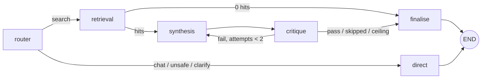

# DocuMind AI — architecture

A walkthrough of how one question becomes one cited answer, and why each boundary is where it is.
Code paths are given as `file.py:line` so this document can be checked against the source rather than
trusted.

Everything here is scoped to what the project actually is: **a production-ready free-tier portfolio
demo**, not a multi-tenant SaaS. Where a decision was made to fit a free tier, that is stated rather
than smoothed over.

---

## 1. The shape of the system

```
 Browser ──(1)──> Next.js 16 on Vercel ──(2)──> FastAPI on Render (Docker)
                        │                              │
                   SSE frames                   LangGraph StateGraph
                 (meta/citations/                router → retrieval → synthesis
                  status/token/done)             │            ↑           │
                                  direct ────────┘            └── critique ┘
                                                                  │
                                    ┌─────────────────────────────┴──────┐
                                    ▼                                    ▼
                             Pinecone (chunks)                   MongoDB Atlas (metadata,
                             + local embeddings                  conversations, messages)
```

Four components, each with one job:

| Component | Owns | Never owns |
|---|---|---|
| `frontend/` | rendering, streaming into the DOM, which documents are in scope | any retrieval logic, any trust decision |
| `backend/app/routers/` | HTTP contract, auth dependency, rate limit, SSE encoding | prompt text, agent ordering |
| `backend/app/agents/` + `services/` | the graph, prompts, retrieval rules, ingestion | transport concerns |
| Pinecone + Atlas | vectors + chunk text / metadata + chat history | business rules |

The split that matters most is between **routers** and **agents**: an agent returns a dict, a router
decides how that dict reaches the browser. That is why swapping LangGraph for a plain function chain, or
SSE for WebSockets, would each touch exactly one layer.

---

## 2. One upload, end to end

`POST /api/upload` → `backend/app/routers/documents.py:80`

1. **Validate before reading bytes.** Extension allowlist (`.pdf,.docx,.txt`) and a 10 MB per-file cap,
   both from config — a rejected file never reaches a parser, so a malicious PDF costs nothing but the
   request.
2. **Write the record first.** `create_document_record` inserts `status='uploading'` *before* parsing
   starts, which is what lets the UI show a stuck document instead of a vanished one if ingestion dies.
3. **Return 202, then work.** `run_ingestion` (`services/ingestion.py:83`) runs as a background task:
   `parsing` → extract text → chunk → embed → upsert. The HTTP request never waits on the embedding
   step, which on the free tier's 0.1 CPU can take minutes for a long PDF.
4. **Extract** per file type: PyMuPDF-free stack — `pypdf` for PDFs, `python-docx` for DOCX, plain
   decode for TXT (`services/text_extractor.py`). Each page keeps its page number, because that number
   is what a citation points at.
5. **Chunk** at ~1000 characters with 150 characters of overlap (`services/chunking.py`). Overlap exists
   so an answer that sits on a boundary is not split into two unusable halves; it costs some duplicate
   text, which retrieval then has to collapse (see §4).
6. **Embed locally** with `all-MiniLM-L6-v2` (384 dims, `services/embedding_service.py`). Documents *and*
   queries go through this one module: two embedding models produce vectors in unrelated spaces and the
   cosine score between them means nothing.
7. **Write twice, deliberately.** Chunk text + page + filename land in **Pinecone** metadata (retrieval
   needs the text attached to build a citation without a second lookup); counts, status, and timestamps
   land in **Atlas** (which stores no document body text at all, because M0 is a hard 512 MB cap).
8. **Re-indexing deletes first** (`vector_store.upsert_chunks` → `delete_document_vectors`), so a
   re-upload cannot leave a stale chunk behind to be cited.

Status is polled by the frontend via `GET /api/documents`; `failed` carries a human-readable `error`,
which the UI surfaces inline rather than swallowing.

---

## 3. One question, end to end

`POST /api/chat` → `backend/app/routers/chat.py:105`

```
auth dependency (JWT → owner_id)
  → rate limit (per owner, sliding window)
    → conversation create-or-load
      → LangGraph graph.stream(stream_mode="updates")
        → SSE frames out, one HTTP response
```

### The graph



Six nodes, four of them the "agents" the project is named for (`app/agents/graph.py:69`).

| Node | File | Job | Failure mode it is built around |
|---|---|---|---|
| `router` | `router_agent.py:100` | classify into `search`/`chat`/`unsafe`/`clarify`, with the scoped filenames in the prompt | a model that answers in an unexpected format — `parse_route` reads the `LABEL:` line and defaults to `search`, so a brittle parser does not become a crash and a reason that merely *mentions* another label cannot overwrite it |
| `retrieval` | `retrieval_agent.py:23` | embed the question, query Pinecone, stage chunks + citations | zero hits short-circuits to `finalise` with an honest "not found" — two Groq calls are not spent to buy a fluent, unsourced guess. Before that verdict is reached, a narrow scope gets one unfiltered re-rank, because a whole-document question scores 0.08 against the file it is asking about |
| `synthesis` | `synthesis_agent.py:68` | draft the answer from numbered passages | a rate-limited call degrades to a readable "try again" sentence, not a 500 |
| `critique` | `critique_agent.py:59` | check every claim in the draft against the passages | unparseable verdicts count as **pass**; failing on garbage would spin the loop and burn quota |
| `direct` | `synthesis_agent.py:102` | answer a non-document question, refuse an off-scope one | — |
| `finalise` | `synthesis_agent.py:163` | pick the surviving text, strip the `NOT_FOUND_IN_CONTEXT` sentinel | the sentinel must never reach the UI |

**Why a `StateGraph` and not four chained calls** — the critic→synthesis edge is a *cycle*. Chaining it
means recursion plus a hand-rolled counter; a conditional edge says it directly and the counter lives in
shared state (`MAX_REVISIONS = 2`, `state.py:31`). The second reason is observability:
`stream_mode="updates"` yields each node's delta the moment it commits, which is what lets the UI say
"Searching your documents" instead of spinning for five seconds.

Two design notes worth defending:

- **The bound lives in `should_revise`, not in the critic** (`synthesis_agent.py:157`), so it cannot be
  forgotten when the graph is edited. The ceiling is 2 because the first rewrite fixes a real defect, a
  second is usually the critic and the model talking past each other, and a third spends quota without
  changing the answer.
- **`trace` is the only append-only key** in the state (`state.py`, `Annotated[list[str], operator.add]`).
  LangGraph's default channel behaviour is overwrite-by-latest-write; without the reducer every node
  would erase the history and the client would see only `finalise` — losing exactly the progress the SSE
  layer exists to display. Getting that reducer wrong in the router's own accumulation loop is the same
  bug, which is why `_stream_answer` reimplements it deliberately (`chat.py`).

### Why the answer is buffered, then replayed

The critic needs the whole draft before it can verify it, so nothing streams out during synthesis. Once
verified, `_replay` (`chat.py:188`) re-emits the finished text in ~6-word frames. The user still sees
progress; what they never see is an unverified claim. This is the core trade of the multi-agent design —
**latency in exchange for verification** — and it is why per-node `status` frames exist at all: an
unlabelled five-second wait reads as a hang.

### The SSE contract

Six event names, documented in `models/chat.py`, consumed in `frontend/lib/api.ts`:

| Event | Payload | Why it exists |
|---|---|---|
| `meta` | `conversation_id`, `retrieved` | the client needs the thread id before the answer finishes |
| `citations` | list of `{index, filename, page_number, snippet}` | source chips render while the answer types |
| `status` | `stage`, `label`, `agents` | multi-agent progress is otherwise invisible |
| `token` | `text` | the answer itself |
| `done` | `answer`, `agent_trace`, `citations` | one authoritative payload to persist against |
| `error` | `message` | a mid-stream failure closes the stream honestly |

Two headers make streaming survive deployment (`chat.py:49`): `Cache-Control: no-cache` and
`X-Accel-Buffering: no`, which tells Render's nginx-derived proxy not to buffer the response — without
it every token arrives at once at the end and the whole streaming feature is invisible.

Messages are persisted **before** the `done` frame, so a refresh always shows the full exchange rather
than a question with no reply.

---

## 4. Retrieval rules

`services/retrieval.py` — the half that decides whether a correct answer is even possible.

1. **Scope by owner at the store**, never after. `vector_store.query_similar` always injects
   `{"owner_id": ...}` into the Pinecone filter (`vector_store.py:146`), so a missing filter cannot be
   caused by a forgetful caller. Optional `document_id: {"$in": [...]}` is what "answer from these two
   files" means.
2. **Drop weak matches** rather than padding to `top_k` — a cosine floor of 0.18 for MiniLM-class
   models. Six chunks where three score well means three pieces of evidence and three distractions the
   model will happily cite.
3. **Collapse exact duplicates** (`_deduplicate`), because overlap seeding makes a boundary sentence
   appear in two consecutive chunks and both would compete for a slot.
4. **Number the passages and reuse that numbering for citations.** `build_context_block` and
   `citations_from` iterate the same list in the same order, in the same module, on purpose: a citation
   off by one is worse than none, because it points the reader at a passage that does not support the
   claim. `tests/test_retrieval.py` asserts they agree.
5. **"Not found" is an answer**, not an error to paper over.

---

## 5. Trust boundaries

The frontend is untrusted; the browser is not a security boundary. Everything below is enforced server
side.

**Identity.** A visitor signs up with an email and a password, clicks the confirmation link, and gets a
signed HS256 token (`core/security.py`) whose `sub` is their account id — which *is* the owner id every
Mongo and Pinecone filter already keys on. The frontend stores it in `localStorage` and sends
`Authorization: Bearer …` on every call (`frontend/lib/session.ts`).

- Passwords are Argon2id at `m=19456,t=2,p=1`: OWASP's memory-hard floor, and the ceiling is the 512 MB
  Render free instance the code runs on. bcrypt would let an attacker amortise a GPU across a leaked table.
- Two token kinds share one signing key and are told apart by a `purpose` claim. A verification link
  travels over the least controlled channel here — forwarded, archived by webmail proxies, pasted into
  chat — so it must not also be a credential: `owner_from_authorization` refuses any token carrying a
  purpose, and `/auth/verify` refuses one without it.
- The endpoints say as little as possible about who holds an account. Register and resend answer one
  identical `202` whichever branch they took; an unknown address and a wrong password are one identical
  `401`; and the unknown branch still spends a real Argon2 verification (`blind_verify`) so response time
  is not an enumeration oracle either. The single deliberate exception is the `403` "confirm your email
  first", which reveals an account that cannot do anything yet.
- The README publishes one shared, pre-confirmed account so a reviewer needs no inbox. It is an ordinary
  namespace with ordinary limits, and whatever is uploaded through it is public by design.
- `JWT_SECRET` is refused at boot when shorter than 32 characters (RFC 7518 for HS256; PyJWT warns on
  every call otherwise).
- In production (`ENVIRONMENT=production`) a request with no valid token is rejected outright; the
  `X-Demo-Key` fallback exists only outside production. **That fallback is a local-work convenience, not an
  identity system** — a browser-generated key is trivially reset, so namespaces are not a defence
  against a determined visitor, only against accidents.

**Scoping.** `owner_id` is part of every Mongo filter (`tests/test_metadata_store.py` asserts the query
shape for each one) and every Pinecone filter. Conversation ids are ObjectIds — sequential and guessable
— so an unscoped `find_one` would hand over another user's full chat history from a URL parameter alone.

**Rate limiting.** A dependency-free sliding window (`core/rate_limit.py`): 10 chat / 6 upload per owner
per minute, 5 sign-in attempts per client address per minute, and 8 account-creation attempts per address
per *hour* — the minute-long buckets protect CPU, that one protects a 512 MB Atlas cluster and a personal
mailbox. Chosen over `slowapi` because the rule is three lines and one deque, and it protects
*everyone's* shared Groq quota from one runaway client. Rejected requests carry
`Retry-After`, which the UI shows verbatim. The honest limit: state is per process, so a second Render
instance doubles the allowance — see §8.

**Uploads** are validated by extension and size before parsing, and the limit is enforced before a byte
is read.

**Mail.** `core/mail.py` has three transports behind one `send()`, and the reason there are three is a
hosting constraint, not a preference:

| Transport | Where it runs | What it does |
|---|---|---|
| `console` | default, CI, any clone | writes the whole message, link included, to the log |
| `smtp` | a laptop | `smtplib.SMTP_SSL` to `smtp.gmail.com:465` with a Gmail App Password |
| `brevo` | the deployed demo | one `urllib` POST to `api.brevo.com/v3/smtp/email` on 443 |

Render's free instances drop outbound traffic to SMTP ports 25, 465 and 587, so `smtp` boots, passes its
credential check, and then fails at connect time with a bare `OSError` after the 10 s timeout — while the
visitor is still holding a `202` that promised a link. That is the whole argument for the third row. Both
live transports are refused at boot without their credentials, both bound the socket with the same
timeout, and both log a failure by exception **class** only: a 401 body from a mail provider can echo the
key it refused, and this is the one module that holds it. The exception's numeric status, where it has one,
is the single extra field that is printed — it cannot carry a secret, and it is what distinguishes a wrong
key from an unverified sender.

---

## 6. Observability

`core/logging.py` — one JSON line per record on stdout, tagged with a `request_id`.

- The id lives in a `ContextVar`, assigned by a **pure-ASGI** middleware. Not `BaseHTTPMiddleware`: that
  class wraps the response body in its own stream, which is precisely the wrong thing to place between a
  chat endpoint and an SSE stream that must flush frame by frame.
- ContextVars are copied into the thread Starlette uses for sync generators, so the id survives into the
  threadpool work the chat router does — verified live, e.g.
  `{"logger": "app.routers.chat", "request_id": "6d95a89fc29c", "message": "chat turn completed",
  "conversation_id": "conv-10", "retrieved": 0, "agent_steps": 3, "answer_characters": 262}`.
- The id is echoed as `X-Request-ID` on the response so a user can quote it, and it is bounded to 64
  characters so a header cannot stuff a kilobyte into every log line.
- `/api/health` is excluded from the access log: uptime pings would bury the lines that mean something.
- `X-Demo-Key`/`Authorization` are never logged.

---

## 7. Frontend

Next.js 16 App Router, two routes (`/` and `/verify`), no server rendering of user data.

- `app/page.tsx` is two components: `Home` owns the session (`useSyncExternalStore` over
  `localStorage`, with a `SESSION_PENDING` server snapshot so there is no hydration flash and no
  `setState` in an effect), and `Workspace` is the actual app, keyed on `ownerId` so switching owners
  cannot leave the previous corpus on screen.
- `components/AuthPanel.tsx` is one form in two modes — sign in, create account — because both ask for the
  same two fields. The plaintext password exists only in component state and is never written to storage;
  the email is, because prefilling it is what makes "sign in again tomorrow" one keystroke and it is not a
  credential. `/verify` is the one page that reads the query string, so it renders inside a `<Suspense>`
  boundary and strips the token from the URL once spent.
- `lib/api.ts` is the only file that talks to the document API: auth headers, error unwrapping, and manual
  SSE decoding live there once rather than per component. `lib/session.ts` posts to `/api/auth/*` itself,
  because a sign-in has no token to attach yet and its failures are answers rather than errors.
  `EventSource` is unusable because it only issues
  GET and the question must travel in a body, so the body stream is read and split on the blank line
  that terminates a frame — frames can straddle network chunks, hence the buffer.
- A 401 anywhere triggers `handleUnauthorized()`, which clears the session and returns the visitor to
  the sign-in panel rather than showing a stack of failing requests.
- `cacheComponents: true` with Partial Prefetching; there is no `getServerSideProps`, no `runtime`
  export, and `NEXT_PUBLIC_API_URL` is read as an inline `process.env` member expression because Next
  only inlines literal member expressions into the client bundle.

---

## 8. Testing strategy

`cd backend && pytest` — **341 tests, no network, no credentials.**

| File | Covers | Why it is separate |
|---|---|---|
| `test_chunking.py`, `test_extractor.py` | unit rules of ingestion | deterministic, no model needed |
| `test_ingestion.py` | the pipeline end to end with fake stores | status transitions are the contract the UI reads |
| `test_retrieval.py` | dedupe, scoring, and the numbering invariant | pure logic over a chunk list |
| `test_vector_store.py`, `test_metadata_store.py` | **query shape**: owner filters, delete-before-write | a fake that records calls catches a missing filter that an in-memory fake never would |
| `test_llm_retry.py` | which failures retry, and the mid-stream rule | these tests need a model that *fails* |
| `test_agents.py` | the graph: routing, the revision cycle, zero-hit short-circuit | one integration test per edge |
| `test_api.py` | HTTP contract, SSE frames, uploads, conversations | 2–3 smoke paths, mocked LLM |
| `test_auth.py` | tokens, owner isolation, rate limits, request ids | production mode flipped per test |
| `test_password.py` | the policy, `blind_verify`, the rehash predicate | those rules live in the hashing module, so they are tested there and not through a route |
| `test_user_store.py` | row shape, normalisation, the unique email index | a duplicate signup is only visible as an index violation |
| `test_accounts.py` | signup, verification, sign-in — and what each reveals to an attacker | the no-enumeration promises are observable only over HTTP |
| `test_mail.py` | the SMTP handshake, and the validator that refuses `smtp` without credentials | a captured message proves nothing about a real relay |
| `test_seed_demo_user.py` | the shared demo account, including that it never echoes the password | this script writes to production Atlas |
| `test_logging.py` | JSON lines, `request_id` propagation, health excluded | the log is an interface a reviewer reads |

The rule that keeps this suite worth running in CI: **mock the LLM, never the pipeline.** LLM output is
non-deterministic and costs quota; everything else here is deterministic and free to test. One example of
a rule that only a test can hold: `stream_text` must never restart a stream that already showed the user
words, because the retry appends a second answer mid-sentence — `test_llm_retry.py` caught exactly that
defect while it was still a docstring promise rather than a behaviour.

The frontend has its own suite: `cd frontend && npm test` — **8 component tests** under vitest and jsdom,
no browser and no backend. It exists because a broken `[1]` citation marker renders as perfectly readable
prose with a stray bracket in it. The type check passed, the lint passed, the build passed, and clicking
through the app still showed a sentence — only a test that asserts what the answer bubble actually says
catches that class of defect.

---

## 9. Deliberate limits

Not omissions — decisions, each with a cost attached.

- **No OCR.** Scanned PDFs yield no text and are reported as such rather than guessed at.
- **Local embeddings.** MiniLM is weaker than a hosted 1536-dim model. The trade buys $0 and no rate
  limit on the one step that runs per chunk.
- **Verification before streaming** costs first-token latency for every answer.
- **Rate limiting is per process.** Render's free tier runs one instance, so this is currently true
  globally; a second instance would make each worker count separately.
- **Accounts, not identity infrastructure.** There is a password and a confirmed address; there is no
  forgotten-password flow, no second factor, and no way to change an email. A locked-out visitor registers
  again, which is the right scope for a demo and the wrong one for anything holding real documents.
- **One compiled graph, cached at module level** (`lru_cache(maxsize=1)`): a per-request compile would
  add measurable latency for no benefit, and it means graph state is never shared between requests.
- **No queues, no websockets, no horizontal scaling, no per-user billing.** Each would be the right
  answer at a different scale than this project targets.

---

## 10. If you change something here

| You want to | Touch | Do not forget |
|---|---|---|
| Add a fifth agent | `agents/graph.py` + one node module | append to `trace`, add a `status` label in `chat.py`, and update §3 |
| Change the embedding model | `EMBEDDING_MODEL_NAME` + `EMBEDDING_DIMENSION` | recreate the Pinecone index — mixing models silently destroys retrieval, and `embedding_service` raises at load if the dims disagree with config |
| Change chunk size/overlap | config only | re-embed existing documents; old vectors keep the old shape |
| Add a field to an answer | `models/chat.py` + `frontend/lib/api.ts` | the SSE frame contract is the API's public surface; both ends read it |
| Change how identity arrives | `core/deps.py` + `core/security.py` + `frontend/lib/session.ts` | every router reads `owner_id` from the one dependency, so a new credential only has to produce that; the `purpose` claim is what keeps a mail link out of the API |

---

## 11. Reading order

For a reviewer, or for whoever picks this up next:

1. `app/core/config.py` — what the app needs to exist at all, and why a missing secret is a crash.
2. `app/services/ingestion.py` — the pipeline, in the order a document travels through it.
3. `app/services/retrieval.py` — the rules that decide whether a correct answer is possible.
4. `app/agents/graph.py` — the wiring, and the docstring's argument for a graph over a chain.
5. `app/routers/chat.py` — where the graph becomes a stream the browser can render.
6. `frontend/lib/api.ts` — the same contract seen from the other side.
