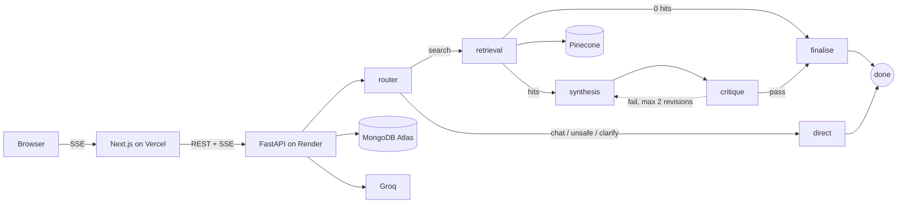

# DocuMind AI

> **Project status:** 🟢 Live. Phases 0–7 complete — ingestion, multi-agent graph, streaming chat UI,
> auth, rate limiting, structured logging, a 203-test suite that runs with no credentials, and a
> deployed backend + frontend. See [Deployment](#deployment-render--vercel) for how it is wired.

**What it is:** a document Q&A demo where answers are verified before you see them. Upload PDFs, DOCX,
or TXT; ask a question; a four-agent LangGraph pipeline retrieves the relevant passages, drafts an
answer with inline citations, and a critic checks every claim against those passages — and can send the
draft back for one revision — before a single word streams to your browser.

That verification step is the whole difference between this and a plain RAG chain, and it is what the
UI's "Checking the answer against your sources" status label is telling you is happening.

**What "production-ready" means here:** production-ready *for a free-tier portfolio demo* — correct,
hardened against obvious abuse, and honest about its limits. Not production-ready for paying users at
scale. Every backing service is on a permanently free tier and no credit card is required to run this.

---

## Live demo

Try it in the browser, or drive the same product locally with the
[offline server](#running-locally-without-any-keys), which needs no keys at all.

| | URL |
|---|---|
| App | https://documind-kappa-indol.vercel.app |
| API health (plain text status line) | https://documind-backend-erw5.onrender.com/api/health |
| Dependency status | https://documind-backend-erw5.onrender.com/api/health/deep |
| Interactive API docs | https://documind-backend-erw5.onrender.com/api/docs |

**Is it up?** `GET /api/health` returns `{"status": "ok", "version": "…"}` from the process itself and
never touches a database — deliberately, because Render restarts a container that fails its health
check, and a five-second Atlas blip should not become a restart loop. `/api/health/deep` is the one that
reports Mongo and Pinecone; it always returns 200 and is meant for a human, never for an automated
restart policy.

A live badge, reading the `status` field straight out of `/api/health`:

[](https://documind-backend-erw5.onrender.com/api/health)

(A `shields.io/endpoint` badge would need the endpoint to return `{"schemaVersion":1,…}`, which
`/api/health` deliberately does not: its shape is the app's own, not a badge vendor's.)

**Access:** the app opens with a single field. Type the access code and the backend mints a session
token scoped to your own document namespace, so every later read and search is filtered to what you
uploaded. The live code is set as `DEMO_ACCESS_CODE` on Render and is deliberately not in this repo:
it is the only thing standing between a stranger's browser and the project's free-tier Groq quota.
Locally, the code is `offline-demo`.

---

## Stack

| Layer | Technology | Tier |
|---|---|---|
| Backend | Python 3.11, FastAPI, Uvicorn | — |
| Agent orchestration | LangGraph (`StateGraph`, conditional edges) | — |
| LLM | Groq, `qwen/qwen3.8-27b` via `langchain-groq` (override with `GROQ_MODEL`) | free |
| Embeddings | `sentence-transformers` / `all-MiniLM-L6-v2`, 384 dims — runs in-process, no API | free |
| Vector DB | Pinecone Serverless (cosine, `aws/us-east-1`) | Starter |
| Document DB | MongoDB Atlas (documents, conversations, messages) | M0, 512 MB |
| Frontend | Next.js 16.4 App Router, React 19.3, TypeScript, Tailwind 4 | — |
| Backend hosting | Render Web Service, Docker | free |
| Frontend hosting | Vercel | Hobby |

---

## How it works



- Retrieval filters every Pinecone query on `owner_id` at the store level, drops weak matches below a
  cosine floor, and collapses the duplicate chunks that overlap seeding produces.
- Passage numbering in the prompt and the citation numbering in the UI come from the same list, in the
  same order — a citation off by one is worse than no citation.
- The answer is buffered while the critic reads it, then replayed in token-sized frames. Verification
  costs first-token latency; that trade is the point of the design.
- Every agent degrades on its own: a rate-limited router still searches, an unusable critic lets the
  draft through, and a dead model produces a readable sentence rather than a 500.

**Full detail, including why a graph rather than a function chain: [`ARCHITECTURE.md`](ARCHITECTURE.md).**

---

## API surface

| Method | Path | Auth | Notes |
|---|---|---|---|
| `POST` | `/api/auth/session` | access code | Returns a HS256 session token; a missing `device_key` gets a new owner namespace |
| `GET` | `/api/health` | none | Liveness, dependency-free |
| `GET` | `/api/health/deep` | none | Mongo + Pinecone status, always 200 |
| `POST` | `/api/upload` | session | Multipart, many files, `202` + background indexing (extension and size validated first) |
| `GET` | `/api/documents` | session | Status per document, newest first |
| `GET` | `/api/documents/status/summary` | session | Counts for the sidebar badge |
| `GET` / `DELETE` | `/api/documents/{id}` | session | Delete removes vectors **and** metadata |
| `POST` | `/api/chat` | session | SSE: `meta`, `citations`, `status`, `token`, `done`, `error` |
| `GET` | `/api/conversations` | session | Thread list, `updated_at` desc |
| `GET` | `/api/conversations/{id}` | session | Messages with citations and the agent trace |

`Authorization: Bearer <token>` is required in production. Outside production an `X-Demo-Key` header is
accepted so local work does not need a login — that fallback is a demo convenience, not an identity
system.

---

## Running locally, without any keys

The whole product — upload, chunking, indexing, the agent graph, SSE streaming — runs against in-memory
stand-ins. This is the fastest way to see the UI, and it needs no Pinecone, Mongo, Groq, or model
download.

```bash
# 1. Backend with every external boundary faked
cd backend
python -m venv .venv && . .venv/Scripts/activate    # macOS/Linux: source .venv/bin/activate
pip install -r requirements-dev.txt
python scripts/serve_offline.py                      # port 8000

# 2. Frontend, in another terminal
cd frontend
npm install
cp .env.local.example .env.local                     # defaults to http://localhost:8000
npm run dev                                          # port 3000
```

Open <http://localhost:3000> and enter the access code **`offline-demo`**.

Honest caveat: offline retrieval scores by word overlap, not embedding similarity. It is a faithful
*shape* of search, not a faithful ranking — use it to exercise the product, never to tune answer
quality.

## Running locally, with real keys

```bash
# The app loads its environment from backend/.env (the path is relative to where uvicorn runs), so the
# template is copied INTO backend/, not to the repo root.
cp .env.example backend/.env
cd backend
python -m venv .venv && . .venv/Scripts/activate    # macOS/Linux: source .venv/bin/activate
pip install -r requirements.txt
uvicorn app.main:app --reload --port 8000
```

| Variable | Where it comes from |
|---|---|
| `GROQ_API_KEY` | [console.groq.com](https://console.groq.com) → API Keys |
| `PINECONE_API_KEY` | [app.pinecone.io](https://app.pinecone.io) → API Keys |
| `PINECONE_INDEX_NAME` | any name; the app creates the index on first use |
| `MONGODB_URI` | Atlas → Connect → Drivers (include the password) |
| `JWT_SECRET` | `openssl rand -hex 32` — must be ≥32 characters or the app refuses to boot |
| `DEMO_ACCESS_CODE` | a code you invent, ≥6 characters; this is what visitors type |
| `CORS_ORIGINS` | comma-separated, e.g. `http://localhost:3000` — never `*` in production |

`.env` is gitignored from the first commit. The app fails fast at import if a required value is missing:
a crash at boot beats a 500 buried inside a LangChain call stack mid-request.

## Tests

```bash
cd backend && pytest -q          # 203 tests, no network, no credentials
ruff check app tests scripts
cd ../frontend && npm run lint && npm run build
```

Nothing in the suite calls a paid API: it mocks the model, never the pipeline. Layout and rationale in
[ARCHITECTURE.md §8](ARCHITECTURE.md).

---

## Deployment (Render + Vercel)

`render.yaml` at the repo root is the backend's service definition, so the shape of the deployment is
reviewable source rather than a dashboard screenshot.

**Backend — Render Web Service (Docker), free plan**

1. Push this repo to GitHub, then *New → Web Service* in Render and pick the repo. Render reads
   `render.yaml`: `dockerContext: ./backend`, `dockerfilePath: ./backend/Dockerfile`,
   `healthCheckPath: /api/health`.
2. Add every secret in Render's dashboard (the Blueprint declares them `sync: false` — values never
   appear in the repo). **Never in the Dockerfile:** `ENV` lines are baked into the image and readable
   by anyone who can pull it.
3. `CORS_ORIGINS` is the one non-secret that deployment needs, so it is a literal in `render.yaml`
   rather than a dashboard value: an origin is visible in every preflight response, and keeping it in
   the file means a Blueprint sync cannot quietly drop it and reopen the API to any page on the
   internet.
4. Start command is the image's `CMD`; Render injects `$PORT` (10000) and uvicorn binds to it.

The live Blueprint is `documind` → service `documind-backend`, built from `main`.

The image pins `torch==2.15.0+cpu` from PyTorch's CPU index. The default wheel drags ~2 GB of CUDA
runtime into a container that will never see a GPU, and the free tier's 512 MB RAM is the binding
constraint here. The embedding model is baked in at build time for the same reason: otherwise the first
question after every cold start spends seconds and ~100 MB of egress downloading MiniLM.

**Frontend — Vercel (Hobby)**

1. Import the same repo, set **Root Directory** to `frontend/`.
2. Add `NEXT_PUBLIC_API_URL` = the Render URL (it is inlined into the client bundle at build time, so
   changing it needs a redeploy).
3. Deploys automatically on every push to `main`.

The project is `documind`, so the production alias is `documind-kappa-indol.vercel.app` — the Vercel
domain carries a random suffix even when the project name is taken, which is why `CORS_ORIGINS` in
`render.yaml` names it in full instead of guessing from the project slug.

**Cold starts — the choice made here.** Render's free instance spins down after ~15 minutes idle and
takes about a minute to wake. This project takes option 1 from `system.md`: **accept it and design for
it.** The gate's error copy tells the visitor the server may be waking up, and the sign-in retry is a
single click. The alternative — a cron pinging `/health` every 10 minutes — would hide the constraint
from visitors while quietly burning the 750 free instance-hours a month, which is not "free" in the
sense that matters. Being explicit about a real limitation is the more production-minded answer.

---

## Known limitations

Stated plainly, because a list of limits is the most honest part of a portfolio project.

- **No OCR.** A scanned/image-only PDF produces no text and is reported as such rather than guessed at.
- **Embedding quality is capped on purpose.** MiniLM (384 dims) is weaker than a hosted 1536-dim model.
  The trade buys $0 and no rate limit on the one step that runs per chunk, which matters more on a free
  tier than benchmark accuracy.
- **Single-user demo, not accounts.** Identity is a shared access code plus a signed token carrying an
  owner id. There is no password, no email verification, no recovery flow, and no tenancy model beyond
  "your namespace is separate from theirs". The `X-Demo-Key` path outside production is a convenience
  and is not an identity system.
- **Rate limiting is per process.** State lives in a `deque` inside one worker, so a second Render
  instance would double the effective allowance. Correct for one free instance; would need Redis above
  that.
- **Free-tier ceilings are real and shared.** Groq caps requests per minute and tokens per day; Atlas M0
  is a hard 512 MB; Pinecone Starter is 2 GB and 2M write units a month. One re-embedding of a large
  corpus is worth thinking about before clicking.
- **A free Render instance cannot speak SMTP.** Outbound traffic to ports 25, 465 and 587 is blocked
  there, so `MAIL_TRANSPORT=smtp` boots, authenticates nothing and fails on connect — the deployed demo
  sends its verification mail through an HTTPS mail API instead (`MAIL_TRANSPORT=brevo`, free to
  300 messages a day). `smtp` stays available for a laptop, where it works.
- **Verification latency.** The critic reads the whole draft before anything streams, so first-token
  latency is several seconds on a multi-agent turn. That is the cost of the feature, not a bug.
- **History window is 8 turns.** Deliberate: an entire multi-year thread in every prompt is slow and a
  silent token-budget leak.
- **Answer quality is non-deterministic.** Same question, different wording, occasionally different
  citations. The citation chips are how you check any individual answer.

---

## Roadmap

| Phase | Deliverable | Status |
|---|---|---|
| 0 · Scaffold | Monorepo, `/api/health`, Docker, env management | ✅ |
| 1 · Ingestion | Upload → parse → chunk → embed → Pinecone + Mongo | ✅ |
| 2 · RAG baseline | Retrieve + generate with citations, SSE streaming | ✅ |
| 3 · Multi-agent | router → retrieval → synthesis → critique, bounded revision loop | ✅ |
| 4 · Frontend | Streaming chat UI, citations, upload + document scope, history | ✅ |
| 5 · Hardening | JWT sessions, rate limiting, retry/backoff, JSON logs, upload validation | ✅ |
| 6 · Testing | 203 tests: unit, integration, smoke, query-shape assertions | ✅ |
| 7 · Deploy + docs | Render + Vercel, this README, `ARCHITECTURE.md` | ✅ live |
| 8 · Portfolio polish (stretch) | Demo video, write-up for Amiru AI Lab / HuggingFace | ⬜ |

Design decision log: [`DECISIONS.md`](DECISIONS.md).

## Licence

MIT.
